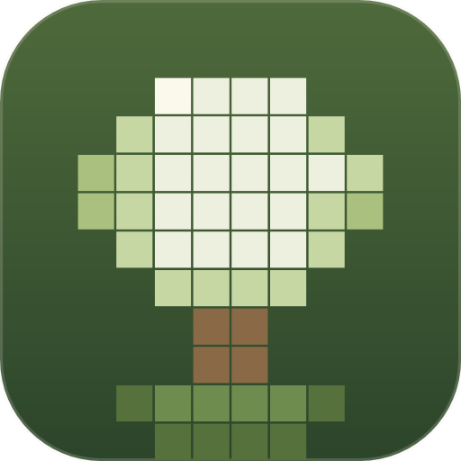
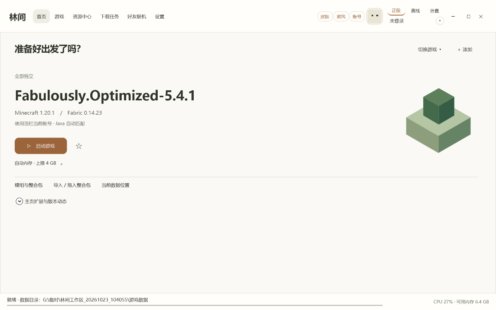
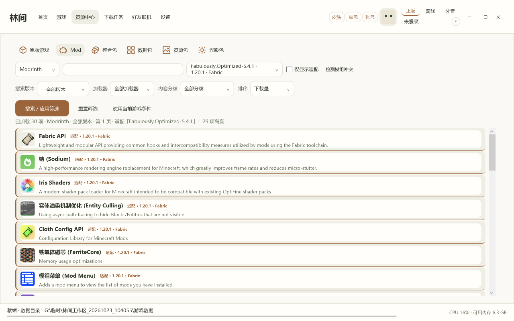
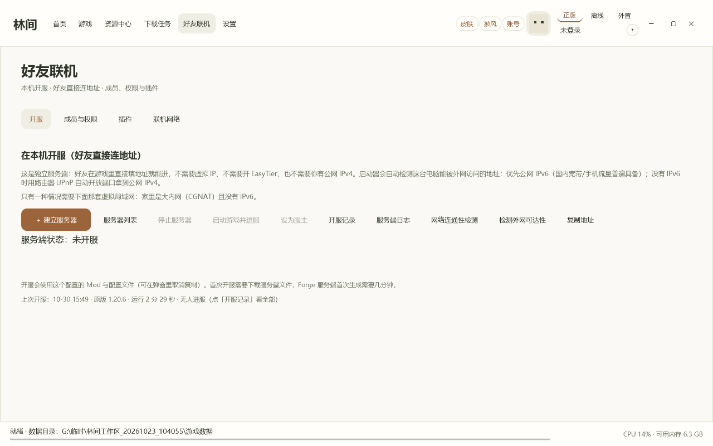
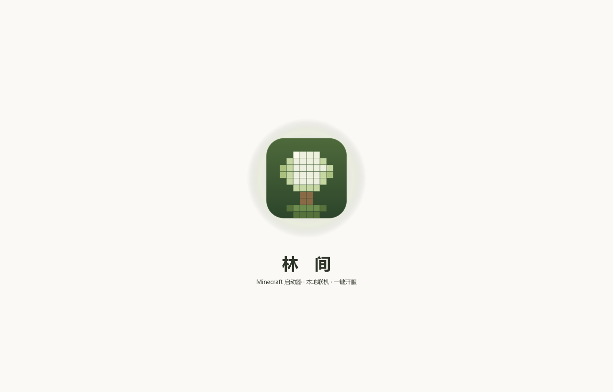
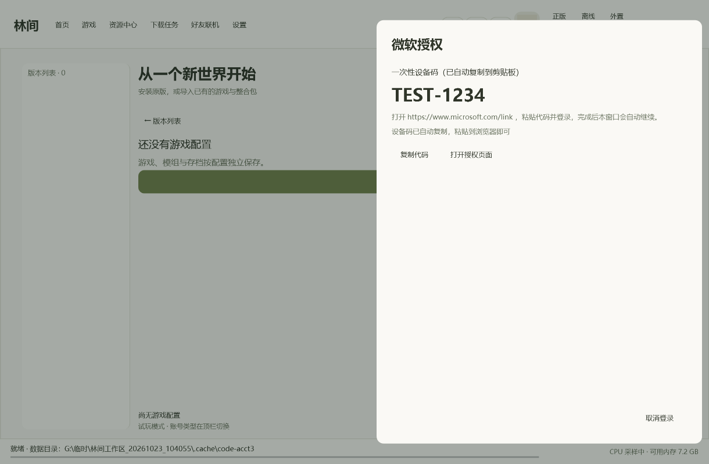

# 林间启动器（Linjian Launcher）

一个面向个人与好友使用的 **Minecraft: Java Edition** 第三方启动器（WPF / .NET 10，Windows）。
A personal, non-commercial third-party launcher for Minecraft: Java Edition (WPF / .NET 10, Windows).

## 下载 / Download

**[⬇ 下载最新版本](https://github.com/wjkclubaaa/ljmcl/releases/latest)** — 单文件 exe，免安装；启动后会自动检查更新。

## 支持作者 / Support

启动器完全免费、无广告、无会员墙，所有功能对所有人一致。

如果它帮到了你，欢迎在爱发电支持我继续维护：<https://afdian.com/a/ljmcl>
（赞助完全自愿，不影响任何功能）

## 这个项目是什么 / What it is

- 个人开发的启动器，供本人和好友使用；不收费、不分发游戏本体。
- 支持：游戏安装与启动、整合包导入、资源下载、本地开服与好友联机、成员权限与插件管理。
- 正版登录使用 **玩家自己的 Microsoft 账号**，走微软官方身份平台。

A personal launcher used by the developer and a few friends. It does not redistribute the
game, is not sold, and does not bundle Mojang/Microsoft assets.

## 界面 / Screenshots

| 主页 Home | 资源中心 Resources |
| --- | --- |
|  |  |

| 好友联机（开服 / 成员与权限 / 插件）|
| --- |
|  |

| 入场动画 | 微软授权（设备码） |
| --- | --- |
|  |  |

## 微软账号登录 / Microsoft account sign-in

应用注册方式（公开信息）：

| 项目 | 值 |
| --- | --- |
| Application (client) ID | `e821166d-c9a3-40c8-8e8f-ba8c3e8716a4` |
| 客户端类型 | Public client（允许公共客户端流） |
| 登录方式 | OAuth 2.0 device code flow（设备码） |
| 重定向 URI | `http://localhost` |
| 客户端密钥 | 无（不使用 client secret） |

授权流程与官方链路完全一致，没有任何绕过：

1. Microsoft OAuth 2.0（`login.microsoftonline.com/consumers`，scope `XboxLive.signin offline_access`）
2. Xbox Live user authentication（`user.auth.xboxlive.com/user/authenticate`）
3. XSTS（`xsts.auth.xboxlive.com/xsts/authorize`，`RelyingParty = rp://api.minecraftservices.com/`）
4. Minecraft 登录（`POST api.minecraftservices.com/authentication/login_with_xbox`）
5. **验证游戏所有权**：`GET api.minecraftservices.com/entitlements/mcstore`
6. 读取档案：`GET api.minecraftservices.com/minecraft/profile`

如果第 5 步无法确认账号拥有 Minecraft: Java Edition，启动器**拒绝启动游戏**。

Security notes:

- 不收集、不上传用户的微软账号密码（页面上从不输入密码，全部在微软官方页面完成）。
- 不把令牌发送给任何第三方；refresh token 仅以 Windows DPAPI 加密保存在本机当前用户下。
- 不使用他人或官方启动器的 Client ID，不伪造客户端标识。

## 说明 / Notes

- 本项目不包含、也不再分发 Minecraft 游戏文件；所有游戏内容均由玩家自己的账号从官方服务下载。
- Minecraft is a trademark of Mojang Synergies AB / Microsoft. This project is not affiliated
  with, endorsed by, or sponsored by Mojang or Microsoft.
- 联系 / Contact: wjk51282711@outlook.com
